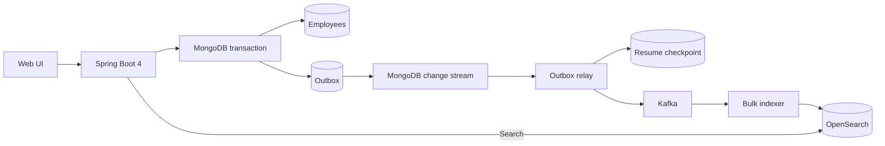

# Implementation plan

1. Clean this Compose project's containers and volumes, then create a local MongoDB replica set, Kafka broker in KRaft mode, and OpenSearch node.
2. Build a Spring Boot 4 API. Commit employee documents and outbox events in one MongoDB transaction.
3. Watch committed outbox inserts with MongoDB change streams. Publish batches to Kafka, then atomically save delivery markers and the resume token after all sends succeed. Recover missing/expired stream history from retained unpublished events.
4. Consume Kafka in batches and bulk index OpenSearch, retrying failures without advancing offsets. Use employee IDs for replay-safe indexing.
5. Generate one million synthetic employees in 500-record transactions. Commit a load checkpoint in each transaction so interrupted loads can resume.
6. Serve a search UI with pipeline counts, load progress, pagination, and nested filters.
7. Verify create-to-search delivery, transaction rollback, nested matching, a Kafka replay, the browser, and convergence of all one million records.

This example supports employee creation. MongoDB is authoritative and OpenSearch is an eventually consistent search projection. It uses an application outbox watched by a MongoDB change stream: writes made directly to the employees collection bypass the pipeline. A single application instance owns the publisher and loader. Scaling either requires coordination. Updates and deletes would require ordered, versioned events before being added.
