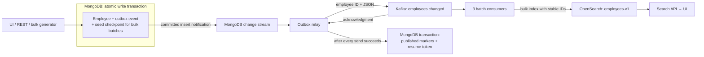

# Employee Search Lab

Spring Boot 4, MongoDB, Kafka and OpenSearch with a browser UI and **one million nested employee records**. The publishing path is event driven: a **transactional outbox + MongoDB change stream + durable resume checkpoint** connects MongoDB to Kafka. There is no scheduled outbox poller.

[Open the UI](http://localhost:8080) · [Detailed architecture and OpenSearch queries](docs/ARCHITECTURE.md) · [Architecture image](docs/architecture.png)

## How it works



1. **Commit the business change.** `EmployeeService` writes employees and outbox events inside one MongoDB transaction. Each event contains the employee ID and its immutable JSON payload. If either insert fails, both roll back. The API returns after MongoDB commits; it does not wait for Kafka or indexing.
2. **Receive committed changes.** `OutboxPublisher` opens a MongoDB change stream on **inserts into `outbox`**. MongoDB delivers committed changes through its cursor. Updating delivery markers does not generate another publishing event because the stream filters out updates.
3. **Publish bounded batches.** One relay worker gathers up to 500 events. It sends them to Kafka with the employee ID as the key, `acks=all`, and producer idempotence enabled. The change-stream cursor waits for new changes; it does not repeatedly query the outbox collection.
4. **Checkpoint after acknowledgment.** After every send in the batch succeeds, a second MongoDB transaction marks those events `published=true` and stores the change stream resume token in `relay_checkpoints`. If Kafka fails, neither markers nor token advance. If the checkpoint transaction fails, the entire batch can be replayed.
5. **Build the search projection.** Three Kafka consumer threads bulk index up to 500 records per poll into OpenSearch. They inspect item-level failures and retry failed batches every two seconds. Offsets are committed only after successful processing. Employee IDs are used as OpenSearch `_id` values, so replay replaces the same documents.
6. **Search the projection.** The browser calls the search API, which queries OpenSearch. Skills and assignments are mapped as `nested`, so conditions on a skill or assignment must match the same array element. Index refresh runs every five seconds; queued events can add further delay.

MongoDB remains the source of truth. A Kafka acknowledgment means the event was accepted by Kafka, **not** that OpenSearch has already indexed it.

## Why Kafka publishing is outside the employee transaction

A MongoDB transaction cannot atomically commit a Kafka send. Publishing before MongoDB commits can expose an event for a transaction that subsequently rolls back. Publishing only after commit leaves a crash window between the two operations.

The outbox closes that loss window by committing the employee and the intent to publish together. Change streams remove scheduled polling while keeping the durable recovery record. This is **at-least-once delivery**, not a distributed exactly-once transaction. Producer idempotence does not remove every application-level resend; stable document IDs make those resends safe for the creation-only workflow implemented here.

## The complete write-to-search flow

There are **two separate MongoDB transactions** and a Kafka consumer acknowledgment boundary. They cannot be combined into one transaction across MongoDB, Kafka and OpenSearch:

```mermaid
sequenceDiagram
  autonumber
  participant U as Browser / API client
  participant A as Spring Boot employee service
  participant M as MongoDB
  participant R as Change-stream relay
  participant K as Kafka
  participant I as Kafka indexer
  participant O as OpenSearch
  U->>A: POST /api/employees (nested employee JSON)
  A->>M: Begin transaction; insert employee + outbox event
  M-->>A: Commit acknowledged
  A-->>U: 201 Created (MongoDB write completed)
  M-->>R: Committed outbox insert in change stream
  R->>K: Send employee JSON; key = employee ID
  K-->>R: Producer acknowledgment
  R->>M: Transaction: published=true + resume token
  M-->>R: Commit acknowledged
  K-->>I: Consumer poll (up to 500 records)
  I->>O: POST /_bulk (index by employee ID)
  O-->>I: HTTP success; every item successful
  I->>K: Listener succeeds; consumer offset can commit
  U->>A: Search request
  A->>O: Query employees-v1
  O-->>U: Search result via API
```

### What each MongoDB collection contains

| Collection | Written by | Purpose |
|---|---|---|
| `employees` | `EmployeeService` | Authoritative employee documents, including embedded address, manager, skills and assignments. |
| `outbox` | `EmployeeService`, then relay marker update | One immutable `UPSERT` event payload per employee creation, plus a `published` delivery marker. This is a **separate collection** in the same MongoDB database and transaction. |
| `relay_checkpoints` | `OutboxPublisher` | Change-stream resume token and update time under `_id=outbox-to-kafka-v1`. It records where Kafka publishing was durably acknowledged. |
| `jobs` | Seed loader | `employee-seed` generation target and completed insert count. This checkpoint is committed with each seed batch; it does **not** track Kafka or OpenSearch. |

For a single create request, `EmployeeService` validates the name, assigns an ID if necessary, serializes the **full employee JSON** into an outbox event, and inserts the employee and event within the same MongoDB transaction. The outbox has its own event ID, the employee ID, `operation=UPSERT`, `payload`, `published=false`, and `createdAt`. If either insert or the commit fails, the transaction does not leave an employee without an outbox event. The API's `201` means this MongoDB transaction committed; it does not promise that Kafka or search has caught up.

For the generator, each transaction inserts **500 employees, 500 outbox events, and the `jobs` checkpoint**. If a batch fails, its employee inserts and checkpoint roll back together, so a later seed request can retry that batch. The generator runs in the app after `POST /api/seed?count=1000000` returns. A restart does not automatically restart the generation worker; issue the seed request again and it resumes from `jobs`.

### Why there is a separate outbox collection

Watching inserts into `employees` directly is a possible design for an insert-only demo. This example uses a separate outbox because it stores a durable **event to be delivered** alongside the business write. The employee document answers “what is the current employee?”; the outbox document answers “which committed event still needs Kafka acknowledgment?” The latter remains queryable even if the MongoDB change-stream history expires. The relay can scan only `published=false` events rather than reconstructing delivery state by scanning every employee.

The separate collection does **not** make MongoDB and Kafka one atomic transaction. The guarantee is that MongoDB commits the employee and its event together; the relay then sends the event at least once. A direct manual insert or update in `employees` bypasses this application's outbox and is not published. The current app creates employees; implementing update and delete flows would also need explicit outbox events, versions and indexing rules.

### How the relay receives and batches committed inserts

MongoDB change streams are the CDC mechanism here. The relay watches **insert operations on `outbox`**, so it sees an event only after the containing MongoDB transaction commits. `published=true` is an update and does not reenter this insert-only stream. There is no timer that queries `outbox` every few seconds during normal streaming.

The relay is one worker. It accumulates **up to 500** change events, stopping sooner when `tryNext()` finds no event ready. MongoDB's `batchSize(500)` bounds a server cursor batch; `maxAwaitTime(200 ms)` bounds how long a cursor fetch may await data. Neither requires waiting for 500 events or creates a 200 ms publishing schedule. A single new employee can be sent promptly. The producer's `linger.ms=10` is a separate, small Kafka network batching setting.

For each relay batch, the code calls `KafkaTemplate.send()` **once per event**, using the employee ID as the Kafka key and the serialized employee as the value. It waits up to 60 seconds for **all** send futures. Kafka producer settings include `acks=all` and `enable.idempotence=true`. After all sends succeed, one MongoDB transaction marks the batch's outbox events `published=true` and saves the cursor's resume token. If any future fails or times out, **neither marker nor token advances**. The relay reconnects after two seconds and can resend some events. It never deletes an event merely because the send was attempted.

The relay batch, Kafka producer's network batches and Kafka consumer poll batch are **three different boundaries**. “Batch processing” here means bounded groups for throughput; it does not mean waiting for a scheduled job. The visible delay also includes broker load, consumer backlog, OpenSearch indexing and its five-second refresh interval.

### Kafka to OpenSearch: connection, indexing and acknowledgment

Kafka carries events on `employees.changed`, with **three partitions** in this demo. The Spring Kafka listener group is `employee-indexer`, with three consumer threads and at most 500 records per poll. A partition is assigned to one consumer in that group at a time. The indexer receives a list of employee JSON strings and calls `OpenSearchService.indexBatch()`.

On first use, the service checks `employees-v1` with an OpenSearch `HEAD` request and creates it if missing. The mapping gives exact-match `keyword` fields to IDs, department, city and similar fields; text fields to names and title; and `nested` mappings to `skills` and `assignments`. This matters because `skill=Java` and `minSkillLevel=4` must match the **same skill object**, and project and role must match the **same assignment object**.

The indexer constructs OpenSearch newline-delimited JSON with two lines per employee, then sends one `POST /_bulk` request for the listener batch. Conceptually:

```json
{"index":{"_index":"employees-v1","_id":"employee-123"}}
{"id":"employee-123","firstName":"Ava","skills":[{"name":"Java","level":4}],"assignments":[{"project":"Project 4","role":"Lead"}]}
```

The `_id` comes from the employee ID. OpenSearch `index` replaces a document with that ID, which makes replay of an identical creation event safe. The service treats an HTTP error **or any bulk item error** (`errors=true`) as failure, even if other items in that HTTP request succeeded. Only after the whole listener call succeeds may the Kafka container commit the consumed offsets. On error, its handler retries the batch every two seconds with unlimited attempts. Already indexed items may be sent again. There is no dead-letter topic or automatic skip, so a permanently bad event can hold up its partition until repaired.

An OpenSearch bulk success means the write was accepted; the index refresh is configured for **five seconds**, so a just-indexed employee may take a little longer to appear in search. The search API queries OpenSearch, not MongoDB. Kafka offsets and `relay_checkpoints` answer different questions: the relay token tracks **MongoDB → Kafka**, while Kafka consumer offsets track **Kafka → OpenSearch**.

## Failure and restart behavior

The key recovery rule is **advance a checkpoint only after the next system acknowledges success**. Some acknowledgments are ambiguous at crash time, so the system chooses replay over loss. Replay is why delivery is at least once.

| Failure point | Durable state and observed result | Recovery behavior |
|---|---|---|
| Validation or JSON serialization fails before the employee transaction | No new employee or outbox event. The API returns an error. | Correct the request and retry. |
| Employee or outbox insert fails, or MongoDB aborts the transaction | Neither employee nor event from that transaction is committed; a seed batch's `jobs` checkpoint also does not advance. | Retry the request or reissue the seed request. For an uncertain client response after a commit, check the employee ID before retrying: this create API does not implement a general idempotency-key protocol. |
| API process stops **after** MongoDB commit but before the client receives `201` | Employee and outbox event both exist, but the client may not know whether the request succeeded. | Restart the app; relay publishes the committed event. Check the employee ID before submitting the same create again. |
| Relay is offline while MongoDB has committed outbox events | New events remain `published=false`. If only Kafka is down, the API can still commit employees and backlog grows. If the whole app is down, this app's API and seed worker are also unavailable. | Relay resumes at startup. Monitor pending outbox count and MongoDB disk space during a long Kafka outage. |
| Kafka send fails, times out, or only some records in a relay batch were acknowledged | No marker or resume-token advancement for that batch. Successfully sent records may already be in Kafka. | Relay retries after two seconds. Some events can appear in Kafka more than once; stable OpenSearch IDs absorb identical replays. |
| Relay process stops after **all** Kafka sends succeeded but before its MongoDB checkpoint transaction commits | Kafka can contain the records; outbox markers/token still indicate an earlier position. | Restart resumes from the previous position and resends the batch. This is the intentional at-least-once window. |
| MongoDB checkpoint transaction fails while marking events and saving the token | Marker changes and token update roll back together. | Relay retries without advancing the token. It may resend already accepted Kafka records. |
| Relay stops after its checkpoint transaction commits | The batch is marked published and the saved token points beyond it. | Restart loads the token from `relay_checkpoints` and calls `resumeAfter(token)`. The consumer can still be behind; relay success is not indexing success. |
| Kafka consumer stops before OpenSearch accepts the bulk request | Its offsets have not advanced for that work. | Kafka redelivers after restart or rebalance; indexer retries. |
| OpenSearch is unavailable, an HTTP request fails, or one bulk item fails | The listener throws; Kafka offsets for the failed batch are not committed. Some earlier items in a partially successful bulk request may already be indexed. | The batch is retried every two seconds. The same `_id` overwrites any already indexed copy. Check OpenSearch and app logs if it cannot progress. |
| Indexer stops after OpenSearch bulk success but before committing Kafka offsets | Documents may exist, but Kafka still considers the batch unprocessed. | Kafka redelivers; indexing with the same `_id` is repeated. |
| OpenSearch accepted writes but search does not show them yet | Kafka lag may be zero while index refresh has not run. | Wait for the configured five-second refresh, then query again. |
| MongoDB is unavailable | Employee writes fail; relay cannot read its stream or save checkpoints. | Restore MongoDB. The app reconnects/retries; check committed records and pipeline status afterward. |
| Kafka broker data or the OpenSearch index is lost independently | Outbox `published=true` only proves a previous Kafka acknowledgment. It does not prove the broker retained data forever or the search index still exists. | Restore durable Kafka/OpenSearch data, or deliberately replay retained Kafka events / rebuild from MongoDB. The current app has no automatic full reindex command. |
| A permanently invalid outbox event or Kafka record blocks progress | Relay or consumer repeatedly fails at that position; no event is silently discarded. | Inspect the bad record and logs, repair the data or implement a controlled dead-letter/replay procedure. |

### Exact relay restart and expired-history sequence

Suppose the saved token is after event **A**. Events **B** and **C** commit while the relay is down. On restart, it reads `relay_checkpoints/outbox-to-kafka-v1`, opens the outbox change stream with `resumeAfter(token A)`, and receives B and C **if MongoDB still retains that change-stream history**. It sends them to Kafka, then atomically marks B/C published and saves the token after C. If the process stops after Kafka accepts B but before that checkpoint, it resumes after A and sends B again. The marker and token are stored together so the checkpoint cannot claim delivery that the outbox markers do not claim.

On a fresh deployment with no token, the relay first captures MongoDB's logical cluster time as a **fence**, then scans `published=false` outbox events in batches of 500. After the scan, it opens the stream at that earlier time. An insert concurrent with the scan is therefore covered by the stream, even if the scan missed it. It may also be included in both the scan and stream, yielding a safe duplicate. This scan happens at bootstrap or history-loss recovery, **not on every normal batch**.

MongoDB change-stream tokens depend on retained oplog history. If resuming fails specifically with `ChangeStreamHistoryLost` (MongoDB error 286), the relay removes the expired token and performs the fenced `published=false` recovery scan. Unpublished outbox records make this possible after a long outage. Other token, permission or collection errors remain visible as `RETRYING`; they are not silently treated as history loss. While streaming with no events, the relay also saves a safe cursor token roughly every ten seconds, keeping the position recent. The relay status endpoint exposes state, last error, checkpoint time and history recovery count.

The relay has **one intended owner**. Do not run multiple application replicas against this checkpoint without adding lease/leader fencing or splitting the relay into a supervised single-owner service. The local Kafka topic has one replica, and the local OpenSearch index has zero replicas; the example demonstrates the flow and failure semantics, not node-level high availability.

## Startup and recovery

**Normal restart:** load `relay_checkpoints/outbox-to-kafka-v1`, open the stream with `resumeAfter`, and continue after the last durably acknowledged position. Events committed while the app was stopped remain in MongoDB's oplog and are delivered on resume.

**First deployment or migration from the polling version:** capture MongoDB's current logical cluster time **before** scanning existing unpublished outbox events. Publish pending events in bounded batches, then start the stream at the captured time. Inserts racing with the scan are covered by the stream. Some can be sent twice; none are intentionally skipped.

**Expired oplog history:** on MongoDB error `286` (`ChangeStreamHistoryLost`), discard the expired checkpoint and perform the same fenced backlog recovery. This works because unpublished outbox records are retained independently of the oplog. Invalid tokens, authorization failures and other errors are surfaced as `RETRYING`; they are not silently treated as history loss.

**Idle stream:** save a safe cursor high-water-mark token roughly every ten seconds. This keeps the checkpoint current even when the outbox receives no new inserts. No Kafka sends or outbox scans are needed for an idle checkpoint.

**Kafka or MongoDB outage:** retain the durable checkpoint and reconnect with a two-second retry delay. Pending outbox entries remain available. A send timeout can leave an uncertain Kafka result, so recovery may resend that batch.

The recovery scan is a startup/history-loss operation, not a periodic publishing scheduler. The stream uses a 200 ms maximum server wait to bound shutdown and batch latency. It still receives changes as they arrive.

## Run

Versions: Java 21, Spring Boot 4.0.8, MongoDB 8.0, Kafka 3.9.1 and OpenSearch 3.6.0. Docker Desktop with 6–8 GB memory provides comfortable headroom; the example has also run with 4 GB.

```bash
# Start or upgrade the existing stack while keeping its data
# This also migrates from the former polling publisher.
docker compose up --build -d
```

Open [http://localhost:8080](http://localhost:8080). The UI supports creating nested JSON employees, generating/resuming one million employees, viewing relay status and comparing database/search counts.

To deliberately reset this example's data before a fresh run:

```bash
# Destructive: removes ONLY this Compose project's containers and named volumes
docker compose down --volumes --remove-orphans
docker compose up --build -d
```

All service ports are bound to `127.0.0.1`. The services have no authentication in this local demo.

## Inspect OpenSearch and pipeline status

| Purpose | Endpoint |
|---|---|
| Search UI | [localhost:8080](http://localhost:8080) |
| OpenSearch REST, no credentials | [localhost:9200](http://localhost:9200) |
| Five employee documents | [employees-v1/_search](http://localhost:9200/employees-v1/_search?size=5&pretty) |
| Employee count | [employees-v1/_count](http://localhost:9200/employees-v1/_count?pretty) |
| Pipeline counts | [api/stats](http://localhost:8080/api/stats) |
| Change-stream relay state | [api/pipeline/relay](http://localhost:8080/api/pipeline/relay) |
| Bulk job progress | [api/seed](http://localhost:8080/api/seed) |

Relay states are `STARTING`, `RECOVERING`, `STREAMING`, `RETRYING` and `STOPPED`. Its endpoint also reports the last checkpoint time, last error, history-recovery count, and deliveries since this app start. Deliveries can include replays and are not a unique employee count. `STREAMING` describes the MongoDB relay, not the health of every downstream service.

```bash
curl 'http://localhost:8080/api/search?q=Ava&department=Engineering&city=Bengaluru'
curl 'http://localhost:8080/api/search?skill=Java&minSkillLevel=4'
curl 'http://localhost:8080/api/search?project=Project%204&role=Lead'
curl 'http://localhost:8080/api/stats'
curl 'http://localhost:8080/api/pipeline/relay'
curl 'http://localhost:9200/employees-v1/_count?pretty'
docker compose exec -T kafka /opt/kafka/bin/kafka-consumer-groups.sh \
  --bootstrap-server localhost:29092 --describe --group employee-indexer
docker compose logs -f app
```

Exact filters are case sensitive. Pagination uses `page` (zero based) and `size` (1–100), up to the first 10,000 matches. Refine filters beyond that window. `_cat/indices` includes hidden nested Lucene documents; use the index `_count` API to count employees.

Use these checks in order: `api/stats` reports the MongoDB employee count, unpublished outbox count and OpenSearch root-document count; `api/pipeline/relay` shows whether MongoDB-to-Kafka delivery is streaming or retrying; the Kafka consumer-group command reports the indexing consumer's lag. Pending outbox events point to the relay/Kafka side. Low pending count with consumer lag points to Kafka-to-OpenSearch indexing. Zero lag with a temporarily missing search hit can be OpenSearch's refresh delay. Equal counts and zero pending/lag are useful convergence signals, though counts alone cannot prove that every individual ID matches. Search a known employee ID or inspect the index when exact reconciliation matters.

From the **host**, connect to MongoDB at `mongodb://localhost:27017/employees?replicaSet=rs0&directConnection=true`, Kafka at `localhost:9092`, and OpenSearch at `http://localhost:9200`. Inside Compose, use `mongo:27017`, `kafka:29092`, and `http://opensearch:9200`; the Docker service name `mongo` is not normally resolvable from a host process. These endpoints are for the local unauthenticated demo.

## Million-record generator

`POST /api/seed?count=1000000` starts a background job. Each transaction inserts 500 employees, 500 outbox events and a job checkpoint. An employee contains an address, skills, assignments and manager data. Seed IDs (`emp-0`, etc.) are reserved for the generator.

After an app restart, click the load button to resume the job explicitly. Requesting the same completed target is a no-op; increasing the target extends the dataset up to 2,000,000. The stored seed checkpoint and the relay resume token are separate: one tracks employee generation, the other tracks Kafka delivery.

## Verify

```bash
mvn test
# Real MongoDB tests: transactions, bootstrap, change-stream resume,
# Kafka-ack failure, and atomic delivery-marker/checkpoint persistence
RUN_MONGO_IT=true mvn test
# Exercise live API -> MongoDB -> change stream -> Kafka -> OpenSearch
python3 scripts/verify.py
# Also load/resume 1M generated employees and wait for convergence
python3 scripts/verify.py --million
# Fault test: briefly stop Kafka and the app, preserving all data and volumes
python3 scripts/verify_recovery.py
```

Integration tests create and remove the dedicated `employee_atomicity_test` and `employee_relay_test` databases. Kafka acknowledgment failures are simulated in the relay integration tests; the end-to-end script uses the actual Docker Kafka broker and OpenSearch. The history-loss error classification is tested; those tests do not truncate the real oplog.

The recovery script deliberately interrupts this project's Kafka and app containers. It creates an employee during the Kafka outage, verifies the event remains unpublished, restarts the app, and checks that exactly one matching document reaches OpenSearch. Results are saved in `docs/change-stream-verification.json`.

For local Java development, stop the app container and run `mvn spring-boot:run`. The default MongoDB URI uses `directConnection=true` for the Docker replica-set address. The UI is served by Spring Boot and requires no Node build.

## Scope and production considerations

- **One app instance owns the relay and loader.** There is no leader election or lease fencing. Before scaling the API horizontally, split out a single supervised relay or use a managed CDC connector with durable offsets; do not run multiple owners of this checkpoint.
- **Employee creation only.** Updates/deletes require versioned events, ordering rules and delete handling before they are safe to add.
- **Retain unpublished outbox records.** They are the recovery source if an outage exceeds oplog retention. Published records are currently retained too; add a retention policy only after defining replay requirements.
- **Do not delete the index or reset Kafka independently and expect automatic repair.** Published markers mean delivery occurred, not that downstream data still exists. Rebuilding a lost index requires deliberate Kafka replay (within its retention) or a MongoDB backfill.
- A poison Kafka record blocks its partition; a poison outbox record blocks the relay. There is no silent drop or dead-letter administration workflow.
- Direct edits to the `employees` collection bypass the outbox. Change streams watch **outbox inserts**, not arbitrary employee changes. Manually changing `published` on an old event does not generate an insert notification and is not a live replay API.
- The local stack has single-node MongoDB, Kafka and OpenSearch. Production requires replication, authentication/TLS, alerting on checkpoint age/backlogs, and an appropriately sized oplog.

See the [MongoDB change-stream documentation](https://www.mongodb.com/docs/manual/changestreams/) for resume-token and oplog-retention requirements. The implemented transaction and failure sequence is in [docs/ARCHITECTURE.md](docs/ARCHITECTURE.md).
