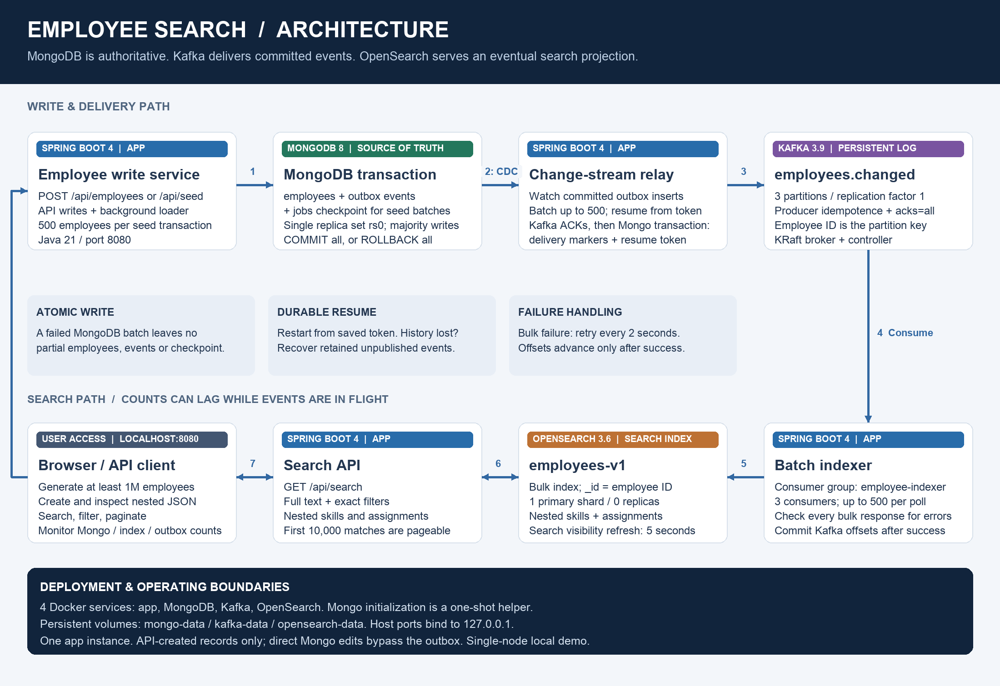
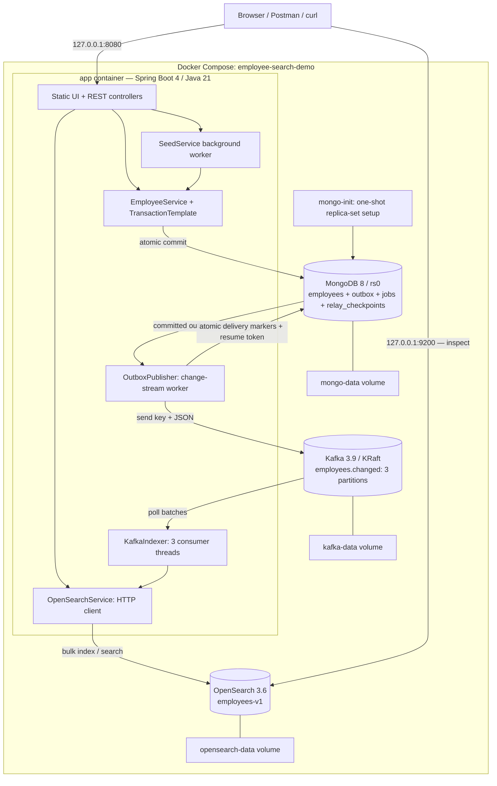

# Employee Search — detailed architecture



[Download the diagram image](architecture.png). The blue boxes above are components inside **one Spring Boot application**, not separate services. This diagram describes the implemented example.

## Connect to OpenSearch and view employees

| Access | Address | Use |
|---|---|---|
| Employee web UI | http://localhost:8080 | Search, generate records, create employees and view their nested JSON |
| OpenSearch from your computer | http://localhost:9200 | REST requests from your browser, terminal or Postman |
| OpenSearch from the app container | http://opensearch:9200 | Internal Docker network address |
| Employee index | `employees-v1` | Searchable employee documents |
| Authentication | None | Security is disabled for this local example; use HTTP, not HTTPS |

Open these links directly:

- [Cluster health](http://localhost:9200/_cluster/health?pretty)
- [Employee count](http://localhost:9200/employees-v1/_count?pretty)
- [First five employees](http://localhost:9200/employees-v1/_search?size=5&pretty)
- [Employee emp-0](http://localhost:9200/employees-v1/_doc/emp-0?pretty)
- [Index mappings](http://localhost:9200/employees-v1/_mapping?pretty)

In search responses, each employee is under **`hits.hits[]._source`**. `_id` is the stable employee ID. `hits.total.value` is the match count; include `track_total_hits: true` for an exact total above 10,000.

In Postman, select **POST**, enter `http://localhost:9200/employees-v1/_search`, choose **Body → raw → JSON**, and paste a query below. Choose **No Auth**. OpenSearch Dashboards is not installed in this Compose stack; the supplied employee UI is at port 8080.

### Basic inspection

```bash
# List the employee index and its storage statistics
curl 'http://localhost:9200/_cat/indices/employees-v1?v'

# Count employee documents
curl 'http://localhost:9200/employees-v1/_count?pretty'

# Fetch one employee by stable ID
curl 'http://localhost:9200/employees-v1/_doc/emp-0?pretty'

# Return a small page of documents and an exact match count
curl -X POST 'http://localhost:9200/employees-v1/_search?pretty' \
  -H 'Content-Type: application/json' \
  -d '{"size":5,"track_total_hits":true,"query":{"match_all":{}}}'
```

`_cat/indices` reports Lucene documents, which include hidden documents for nested array entries. Its `docs.count` can therefore exceed the number of employees. Use **`employees-v1/_count`** to count employees.

### Full text search with exact filters

```bash
curl -X POST 'http://localhost:9200/employees-v1/_search?pretty' \
  -H 'Content-Type: application/json' \
  -d '{
    "size": 10,
    "track_total_hits": true,
    "query": {
      "bool": {
        "must": [{"multi_match": {"query": "Ava", "fields": ["firstName^3", "lastName^3", "title", "manager.name"]}}],
        "filter": [
          {"term": {"department": "Engineering"}},
          {"term": {"address.city": "Bengaluru"}}
        ]
      }
    }
  }'
```

### Advanced nested search

This finds employees whose **same skill entry** has `name=Java` and `level>=4`, and whose **same assignment entry** has `project=Project 4` and `role=Lead`. `inner_hits` shows the exact nested elements that matched.

```bash
curl -X POST 'http://localhost:9200/employees-v1/_search?pretty' \
  -H 'Content-Type: application/json' \
  -d '{
    "size": 5,
    "track_total_hits": true,
    "query": {
      "bool": {
        "filter": [
          {"nested": {
            "path": "skills",
            "query": {"bool": {"filter": [
              {"term": {"skills.name": "Java"}},
              {"range": {"skills.level": {"gte": 4}}}
            ]}},
            "inner_hits": {}
          }},
          {"nested": {
            "path": "assignments",
            "query": {"bool": {"filter": [
              {"term": {"assignments.project": "Project 4"}},
              {"term": {"assignments.role": "Lead"}}
            ]}},
            "inner_hits": {}
          }}
        ]
      }
    }
  }'
```

Nested queries prevent a high level on one skill from satisfying the level condition for a different skill.

The query structure and `inner_hits` behavior are described in the [OpenSearch nested query documentation](https://docs.opensearch.org/latest/query-dsl/joining/nested/). See also the [Count API](https://docs.opensearch.org/latest/api-reference/search-apis/count/) and [Search API](https://docs.opensearch.org/latest/api-reference/search-apis/search/) references.

Create employees through `POST http://localhost:8080/api/employees` or the UI. Direct writes to OpenSearch would bypass MongoDB and the outbox.

## Physical deployment



MongoDB is also published on `127.0.0.1:27017`; Kafka's external listener is `localhost:9092`. Inside Docker, services use `mongo:27017`, `kafka:29092`, and `opensearch:9200`. One MongoDB replica-set member enables transactions, but does not provide failover. One Kafka broker uses replication factor 1. The employee index uses one primary shard and no replicas.

## Transaction and delivery sequence

```mermaid
sequenceDiagram
  autonumber
  participant Client as UI / seed trigger
  participant App as Spring Boot
  participant Mongo as MongoDB rs0
  participant Relay as Outbox publisher
  participant Kafka as Kafka
  participant Indexer as Batch indexer
  participant OS as OpenSearch
  Client->>App: Create employee / start bulk job
  App->>Mongo: Begin transaction
  App->>Mongo: Insert employees and outbox events
  opt Seed batch
    App->>Mongo: Save committed progress checkpoint
  end
  alt Any operation fails
    App->>Mongo: Abort transaction
    App-->>Client: Error / failed batch status
  else All operations succeed
    App->>Mongo: Commit with majority write concern
    App-->>Client: Created / job progress
  end
  Relay->>Mongo: Open outbox insert stream with resumeAfter
  loop Committed insert batches (up to 500 events)
    Mongo-->>Relay: Change events and resume token
    Relay->>Kafka: Send JSON payloads; key = employee ID
    Kafka-->>Relay: Acknowledge sends
    Relay->>Mongo: Transaction: published=true + resume token
  end
  Kafka-->>Indexer: Poll up to 500 records per consumer
  Indexer->>OS: POST /_bulk with stable employee IDs
  alt HTTP or bulk-item failure
    Indexer->>Indexer: Throw and retry after 2 seconds
    Note over Indexer,Kafka: Do not advance past failed batch
  else Whole bulk request succeeds
    Indexer->>Kafka: Listener container commits offsets
  end
  Note over OS: Refresh interval: 5 seconds
  Client->>App: GET /api/search
  App->>OS: Search with nested filters
  OS-->>App: Hits, total and query time
  App-->>Client: Render employee results
```

The seed HTTP request returns after starting the worker; the worker performs the transactions in the diagram asynchronously. A seed batch stores 500 employees, 500 outbox events and its progress checkpoint together. Clicking the load button after a restart resumes from that checkpoint; requesting an already completed target is a no-op.

## Change-stream startup and checkpointing

The relay starts after MongoDB collections are initialized. It resumes using the durable token in `relay_checkpoints`. Only after Kafka acknowledges every record does a MongoDB transaction update delivery markers and the token together. Idle high-water-mark tokens are saved approximately every ten seconds. A stream cursor waits for changes with a 200 ms maximum server wait; there is no scheduled collection poll.

With no checkpoint (including migration from the polling version), capture cluster time **before** recovering existing unpublished events, then watch from that time. Concurrent inserts are therefore covered; replay is safe. Only explicit history-loss error 286 triggers this recovery automatically. Other errors remain visible in `GET /api/pipeline/relay`. Retaining unpublished outbox entries is essential for recovery beyond the oplog window. See the [README recovery walkthrough](../README.md#startup-and-recovery).

## Failure boundaries and guarantees

| Boundary | What can happen | Implemented handling |
|---|---|---|
| MongoDB transaction | A document or outbox insert fails | Roll back the entire batch |
| MongoDB committed; Kafka unavailable | Pending events accumulate | Keep outbox events unpublished and retry |
| Kafka acknowledged; process dies before checkpoint commit | Previously sent events can be sent again | At-least-once delivery; stable OpenSearch IDs replace the same document |
| OpenSearch HTTP or item failure | Indexing a batch is incomplete | Retry the batch; successful items can be replayed |
| OpenSearch succeeded; offset not yet committed | Kafka can redeliver records | Same employee IDs avoid extra search documents |
| Indexing finished; refresh pending | A document may not yet appear in search | Wait for refresh, normally within 5 seconds |
| App restarted | In-memory workers are gone | Relay resumes automatically from its token; restart the seed job explicitly |
| Resume token older than retained oplog | MongoDB reports history lost (286) | Capture a fresh cluster-time fence, drain unpublished outbox events, then watch from that fence |

This is **not an exactly-once distributed transaction**. Kafka producer idempotence does not eliminate application-level resends across the outbox acknowledgment boundary. Search is eventually consistent. Check both `pendingOutbox=0` and matching MongoDB/OpenSearch counts; the Kafka backlog may remain after the outbox is empty.

## Operating limits

- Run one app instance; the publisher and loader do not implement multi-instance leases.
- Employee creation is implemented. Updates and deletes would need event versioning and ordering rules.
- MongoDB change streams watch **outbox inserts**. Direct edits to `employees` bypass event creation. Delivery-marker updates do not retrigger publication.
- A poison event blocks its partition until corrected; there is no dead-letter recovery workflow.
- Published outbox events are retained. Production operation needs retention, alerting, authentication and replicated services.
- The app paginates through the first 10,000 matches. Deep browsing or export should use `search_after` with a stable sort/PIT, or a dedicated export flow.

## Source map

| Responsibility | Implementation |
|---|---|
| Transaction and outbox creation | [EmployeeService.java](../src/main/java/demo/search/EmployeeService.java) |
| Generator and durable checkpoint | [SeedService.java](../src/main/java/demo/search/SeedService.java) |
| Publish and acknowledge | [OutboxPublisher.java](../src/main/java/demo/search/OutboxPublisher.java) |
| Topic, concurrency and retry policy | [KafkaConfig.java](../src/main/java/demo/search/KafkaConfig.java) |
| Consumer entry point | [KafkaIndexer.java](../src/main/java/demo/search/KafkaIndexer.java) |
| Mapping, bulk indexing and nested queries | [OpenSearchService.java](../src/main/java/demo/search/OpenSearchService.java) |
| Containers, ports and volumes | [compose.yaml](../compose.yaml) |
| Diagram generation | [render_architecture.py](../scripts/render_architecture.py) |

The PNG can be regenerated with `python3 scripts/render_architecture.py` in an environment with Pillow installed. The Mermaid diagrams above remain editable as text.
