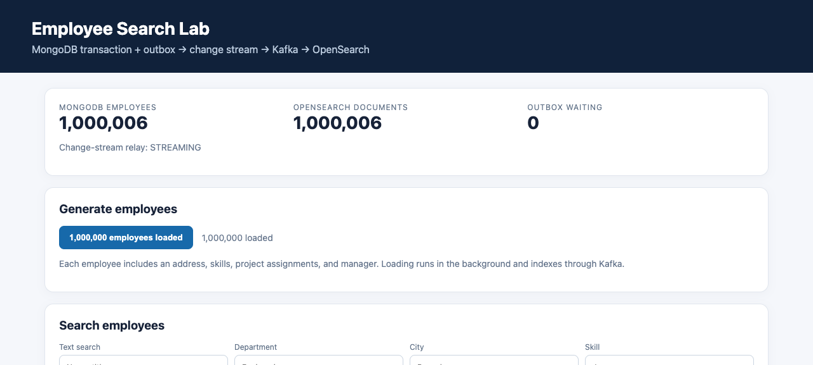

# Verification results

## Change-stream architecture — 29 September 2026

The scheduled publisher was replaced with a MongoDB change-stream relay and an atomic delivery-marker/resume-token checkpoint. The existing million-record dataset was preserved.

| Check | Result |
|---|---|
| Generated employees retained | 1,000,000 |
| MongoDB employees after recovery test | 1,000,006 |
| OpenSearch employees after recovery test | 1,000,006 |
| Unpublished outbox events | 0 |
| Relay status | STREAMING, no error |
| Real MongoDB employee/outbox rollback | Passed |
| Change-stream bootstrap and restart resume | Passed with real MongoDB and a mock Kafka sender |
| Kafka acknowledgment failure | Passed: markers and checkpoint stay unchanged |
| MongoDB checkpoint-write failure | Passed: published markers roll back |
| History-loss error classification | Passed: only error 286 permits automatic reset |
| Live API → change stream → Kafka → OpenSearch | Passed |
| Nested skill and assignment matching | Passed, including cross-element negative cases |
| Live Kafka outage | Employee API still committed to MongoDB; event stayed unpublished |
| App restart with pending event | Event recovered and produced exactly one matching search document |

Five Java tests passed with `RUN_MONGO_IT=true mvn test`. The live recovery test uses the actual Docker Kafka broker and OpenSearch. The total includes six employees outside the generated dataset. The tests do not truncate the real MongoDB oplog; history-loss handling is tested at the error-classification boundary.

The fault-test report is [change-stream-verification.json](change-stream-verification.json); the latest ordinary pipeline run is [verification.json](../verification.json). Run instructions and operating limits are in [README.md](../README.md).

